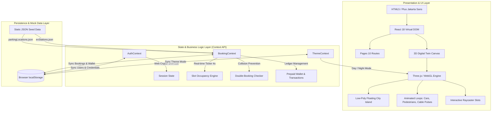
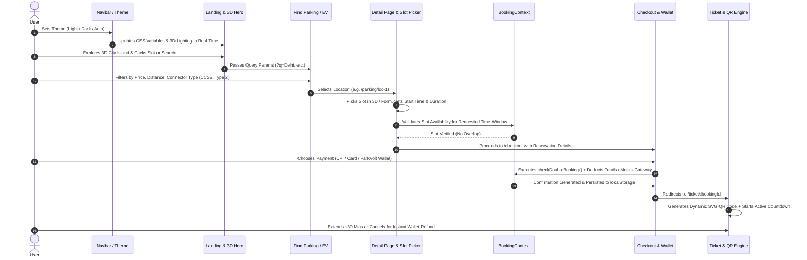
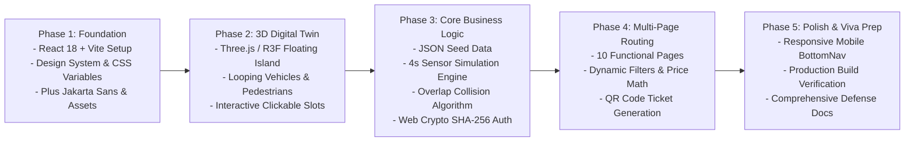

# ParkVolt: Architecture, Roadmap & Technical Deep-Dive

**ParkVolt – Smart Parking & EV Charging Finder** is a client-side digital-twin web application combining **React 18**, **Three.js / WebGL (@react-three/fiber & @react-three/drei)**, **React Router**, and native browser web standards (Web Crypto API, Web Storage, and CSS Variables).

---

## 1. System Architecture

### 1.1 High-Level Architecture Diagram

---

## 2. End-to-End User Journey & Data Flow

---

## 3. Project Roadmap & Lifecycle

---

## 4. Codebase Blueprint: Which File Does What?

### 4.1 State Management & Context (`client/src/context/`)

1. **`ThemeContext.jsx`**:
   - Manages `'light'`, `'dark'`, and `'auto'` theme states.
   - Listens to device appearance via `window.matchMedia('(prefers-color-scheme: dark)')`.
   - Modifies `data-theme` on the `<html>` root element so CSS variables update instantly.
   - Supplies `isDark` boolean to Three.js lights, materials, and fog.

2. **`AuthContext.jsx`**:
   - Handles simulated user registration and login.
   - Uses browser-native **Web Cryptography API** (`window.crypto.subtle.digest('SHA-256', ...)`) to hash passwords client-side before storing or comparing.
   - Pre-seeds a default demo account: `alex@parkvolt.com` / `password123`.
   - Persists active login state in `localStorage`.

3. **`BookingContext.jsx`**:
   - Central business logic engine of ParkVolt.
   - **Real-Time Simulation**: Runs a 4-second `setInterval` that fluctuates slot availability up and down to replicate live IoT ultrasonic sensors.
   - **Double-Booking Algorithm**: Inspects start and end timestamps against all confirmed tickets for the same slot ID to guarantee no overlapping reservations.
   - **Wallet Ledger**: Manages prepaid balance in INR (₹) and maintains an immutable transaction history for top-ups, reservations, extensions, and refunds.

---

### 4.2 3D WebGL Digital Twin (`client/src/components/3d/`)

* **`FloatingCityScene.jsx`**:
  - Encapsulates Three.js via `@react-three/fiber` `<Canvas>` and `@react-three/drei`.
  - **`IslandEnvironment`**: Procedural circular island with asphalt road ring, yellow lane markings, low-poly tiered trees, street lamps with night lights, and levitating neon core.
  - **`ModernBuildings`**: Multi-tiered architectural skyscrapers with window matrices that light up in dark mode, rooftop helipad, blinking aviation warning beacons, and an animated rotating 3-blade wind turbine.
  - **`EvChargingSuperhub`**: Solar canopy with photovoltaic cells, LED edge lighting, charging kiosk, and a connected Tesla-style car with animated energy pulses moving along the charging cable.
  - **`InteractiveParkingLot`**: 6 generously spaced bays with concrete borders. Integrates Three.js raycasting (`onClick`) with `<Html>` overlay tags displaying slot IDs and hourly pricing.
  - **`AnimatedCar`**: Looping vehicles with spinning wheels, front headlights, and red rear lightbars that follow parametric oval trajectories.
  - **`WalkingPedestrian`**: Animated human figures with forward kinematic limb swinging (legs and arms oscillate using sine waves).
  - **`DriftingClouds`**: Floating low-poly volumetric clouds rotating slowly above the skyline.

---

### 4.3 Layout & Common Components (`client/src/components/`)

1. **`layout/Navbar.jsx`**: Top navigation header containing the ParkVolt brand logo, navigation links, simulated data badge, theme toggle menu (Light/Dark/Auto), and user wallet balance badge.
2. **`layout/Footer.jsx`**: Comprehensive footer with brand mission, quick links, INR currency disclosure, and Unsplash photo credits.
3. **`layout/BottomNav.jsx`**: Sticky mobile navigation dock for small screens (<768px).
4. **`common/ToastNotifications.jsx`**: Toast notification queue displaying pop-up alerts for actions like booking confirmations, extensions, top-ups, and cancellations.

---

### 4.4 The 10 Application Pages (`client/src/pages/`)

1. **`LandingPage.jsx` (`/`)**:
   - 3D Hero section showcasing the interactive floating island.
   - Integrated quick-search bar routing directly into the search catalog.
   - Live simulated stats counters (Active Bays, Superchargers, Carbon Saved, Uptime).
   - Featured location cards with live pricing, peak-hour badges, and favorite buttons.
   - 4-step "How ParkVolt Works" guide, feature benefits, INR pricing tiers, and FAQ accordion.

2. **`FindParkingPage.jsx` (`/find-parking`)**:
   - Faceted search by facility name or city (Gurugram, New Delhi, Mumbai, Bengaluru).
   - Filter controls: price slider, availability toggle, and amenity tags (Covered, EV, CCTV, Valet).
   - Grid cards with authentic photos, live free slot counts, hourly rates, and opening hours.

3. **`ParkingDetailPage.jsx` (`/parking/:id`)**:
   - High-res photo gallery and facility specifications.
   - Embedded 3D slot picker allowing users to click free bays directly in 3D.
   - Start time and duration picker (from 30 minutes up to 24 hours).
   - Real-time price calculator breakdown (Base Fare + 18% GST).
   - Direct Google Maps directions link with real GPS coordinates.

4. **`FindEvChargingPage.jsx` (`/find-ev`)**:
   - Filter matrix by connector standard (`CCS2`, `Type 2`, `CHAdeMO`, `Bharat AC001`, `Bharat DC001`).
   - Filters for charging speed (>50 kW Superchargers) and status (Available vs Charging).
   - Station cards displaying power output in kW, price per kWh, and occupancy status.

5. **`CheckoutPage.jsx` (`/checkout`)**:
   - Itemized order review with date, slot code, and duration.
   - Triple payment gateway simulation: UPI (`user@upi`), Credit/Debit Card (16-digit validation), and ParkVolt Prepaid Wallet.
   - Pre-checkout double-booking verification.
   - Clear "Demo Payment" security badge with an animated success state.

6. **`BookingTicketPage.jsx` (`/ticket/:id`)**:
   - Dynamic SVG QR code generated with `qrcode.react` encoding the booking payload for gate scanners.
   - Active countdown timer reflecting remaining parking duration.
   - Quick **"+30 Mins"** extension button updating the reservation and recalculating cost.
   - Instant **Cancel Booking** button triggering an automatic refund back to the user's wallet.

7. **`MyBookingsPage.jsx` (`/my-bookings`)**:
   - Three tab views: `Upcoming`, `Active`, and `Past`.
   - Card summaries with slot codes, directions, QR preview, and direct ticket links.

8. **`WalletPage.jsx` (`/wallet`)**:
   - Digital wallet balance display card in INR (₹).
   - One-click top-up chips (+₹200, +₹500, +₹1,000) with simulated payment processing.
   - Transaction ledger recording top-ups, parking deductions, extensions, and refunds.

9. **`AuthPage.jsx` (`/login` & `/register`)**:
   - Unified tabbed authentication form.
   - Browser-side SHA-256 password hashing.
   - Form validation with demo credentials helper (`alex@parkvolt.com` / `password123`).

10. **`NotFoundPage.jsx` (`*`)**:
    - Clean 404 error page with navigation shortcuts back to safety.

---

## 5. Key Viva Technical Explanations

### Q1: How does the 3D scene work without freezing the browser?
> **Answer**: Three.js renders via WebGL on the GPU, completely off the JavaScript main CPU thread. With `@react-three/fiber`, each 3D entity is a lightweight declarative component. Performance is maintained by:
> 1. Capping pixel ratio at `dpr={[1, 2]}` to prevent GPU overload on high-DPI Retina screens.
> 2. Reusing low-poly geometries (`boxGeometry`, `cylinderGeometry`) and standard materials.
> 3. Running animations inside `useFrame` delta-time callbacks rather than heavy state re-renders.

### Q2: How is double-booking prevented without a database server?
> **Answer**: The application uses an interval collision detection algorithm in `BookingContext.jsx`:
> Two reservations for the same slot collide if and only if:
> $$\text{ExistingStart} < \text{NewEnd} \quad \text{AND} \quad \text{ExistingEnd} > \text{NewStart}$$
> If this condition evaluates to true for any confirmed ticket, the reservation is rejected, alerting the user to choose another time or slot.

### Q3: Why is Web Crypto API used instead of plain text storage?
> **Answer**: Even in a prototype or client-side application, storing passwords in plain text inside `localStorage` is vulnerable to XSS attacks. By using `crypto.subtle.digest('SHA-256', utf8Bytes)`, passwords are transformed into a one-way cryptographic hexadecimal hash, demonstrating industry-standard security fundamentals.
